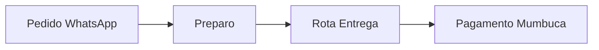
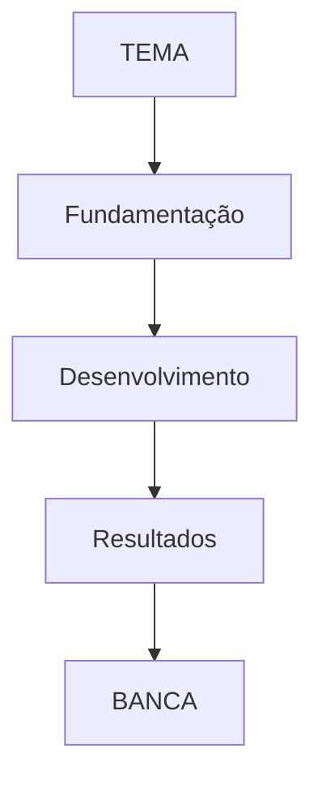
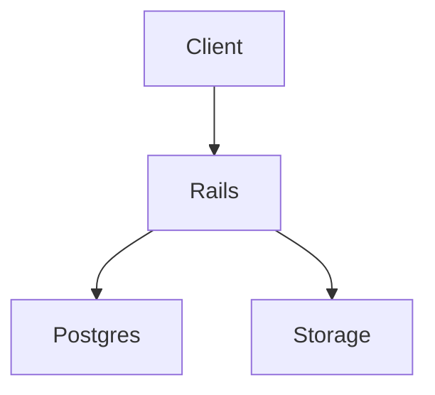

# Ideias Extensionistas — SpecLine / PEI VI Maricá + Oficina Presencial 17/10/2026

> **Projeto:** SpecLine — Plataforma Unificada de Engenharia de Produto
> **Disciplina:** Práticas Extensionistas Integradoras VI (2026.2) — FUSVE Campus Maricá
> **Discente:** Diego Silva Pereira Pacheco (202413831)
> **Docente:** Profª. Laís Cristine Bordallo Pinheiro | **Apoio:** Prof. Me. Victor Andrade da Silveira
> **Oficina:** 17/10/2026 (sábado) 09h00–11h30 — Lab 02, Av. Roberto Silveira 437, Flamengo, Maricá/RJ
> **Arquivo gerado em:** 08/10/2026 — para revisão antes da oficina

---

## 1. Diagnóstico atual (o que já está pronto)

### 1.1 Pontos fortes
- **Vínculo territorial dentro do produto:** rotas `/extension` e `/acao-extensionista` (`config/routes.rb`), página `app/views/solutions/extension.html.erb` completa (hero, diagnóstico Maricá, barômetro TCO R$0 / 197 mil hab / 15-30 participantes / 100% aberto, seção `#oficina-presencial`, downloads PDF).
- **Roteiro oficial existente:** `docs/oficina-marica.md` (76 linhas) + PDFs em `docs/academic/` — título, objetivo, materiais, papéis, cronograma 15+20+40+20+20+35, Anexos A (presença) e B (Likert 5Qs).
- **Diagnóstico territorial convincente:** ICTIM / Moeda Mumbuca / polos + barreiras (65,8% impedimento dólar Jira/Confluence/Notion/Miro, 78,9% dispersão, 57,9% perda de requisitos). TCO zero como resposta social.
- **Evidências previstas:** lista física assinada + Likert + 5-10 fotos datadas + ambiente permanente `specline.onrender.com`.
- **Transparência acadêmica:** README §2 institucional, `docs/academic/Planejamento_Gestao_SpecLine_PEI_VI.md`, SPRINTS 9.3 e 16, INFRA §8 Alinhamento Extensão.

### 1.2 Gaps críticos (resolver até 16/10)
| # | Gap | Risco | Correção |
|---|-----|-------|----------|
| 1 | **ODS = 0 menções no repo** | Banca de extensão cobra Agenda 2030 | Declarar ODS 4, 8, 9, 10 na página + plano + relatório |
| 2 | Oficina ainda é "tutorial genérico" | Participante aprende clique, não resolve problema real | Migrar para "Desafio Maricá Real em 3 trilhas" (seção 2) |
| 3 | Sem plano B técnico | Render/Neon/OAuth podem falhar no Lab | Docker local + contas demo + PDF offline (seção 4) |
| 4 | Sem rastreabilidade oficina → sistema | Não dá para provar impacto quantitativo | Código convite `MARICA17` + seed workspace demo (seção 5) |
| 5 | Público heterogêneo, roteiro único | Ensino médio + graduação + dev + líder comunitário dispersam | Trilhas por perfil + checklist gamificado (seção 2) |

---

## 2. Ideia central: trocar "aprender ferramenta" por "resolver Maricá em 150min"

### 2.1 Formato: 3 trilhas com cartão colorido na entrada
Cada participante escolhe 1 cartão na recepção e segue missões daquela trilha:

- **Trilha Laranja — Meu TCC / PBL / PEI**
  Entrega: doc TipTap com sumário + checklist de capítulos + Kanban de entregas + milestone com data da banca.
- **Trilha Verde — Meu Negócio / Projeto Comunitário**
  Exemplos: quentinhas, brechó, barbearia, ONG, igreja, projeto de bairro.
  Entrega: doc de especificação (serviços/preços/processo) + Kanban de pedidos/tarefas + diagrama Mermaid do fluxo.
- **Trilha Azul — Meu Portfólio Dev**
  Entrega: doc de projeto GitHub + whiteboard de arquitetura + Kanban de issues.

> Por que funciona: todo mundo sai com algo **seu** pronto, gera depoimento forte no Likert e foto de tela com valor real.

### 2.2 Caso-âncora local (você monta antes)
Não faça demo de CRUD vazio. Monte 1 workspace exemplo real:

**Exemplo: "Quentinhas da Flamengo — Maricá"**
- Doc: Cardápio da semana (tabela) + processo de entrega
- Kanban: A fazer / Preparando / Entregando / Concluído (5 cards)
- Mermaid: `Pedido → Preparo → Rota → Entrega → Pagamento Mumbuca`
- Mostre preço Jira/Notion/Miro em dólar na tela vs R$0 SpecLine lado a lado (5 min = impacto imediato).

### 2.3 Gamificação: Checklist Carimbo (5 missões)
Imprima checklist pequeno, participante cola adesivo/carimbo a cada missão:

1. [ ] Criar workspace `[SeuNome] Maricá`
2. [ ] Criar doc com comando `/` + checklist + tabela
3. [ ] Criar 3 cards Kanban e arrastar 1 para Doing/Done
4. [ ] Gerar 1 diagrama Mermaid (dar 3 templates prontos para copiar/colar)
5. [ ] Comentar ou convidar colega

Quem completa as 5 ganha "Certificado Mão na Massa" digital na hora (print ou PDF). Competição leve segura atenção nos 40 min de prática.

### 2.4 Roteiro 150min melhorado (mantém seus horários)

| Horário | Etapa | O que fazer diferente |
|---|---|---|
| 09h00–09h15 **Acolhimento** | Lista Anexo A + entrega Kit A4 + cartão trilha | Kit 1 folha frente-verso: QR + login demo `convidado-maricaXX` + 3 passos + espaço ideia. Tenha **5 contas demo já criadas** para quem não consegue OAuth. |
| 09h15–09h35 **Abertura** | 5min dólar x zero + 10min caso Quentinhas + 5min trilhas | Corte slide teórico. Demo viva no projetor. |
| 09h35–10h15 **Prática guiada** | Missões por trilha, não passo-a-passo único | Você narra no microfone, Victor circula. Música baixa. Projetor mostra cronômetro. |
| 10h15–10h35 **Clínica / Mentoria** | Pergunta padrão: "qual projeto você trouxe?" | Modele 1 ideia real por bancada. Fotografe tela + rosto (com autorização). |
| 10h35–10h55 **Avaliação** | Likert papel + Google Forms juntos | Papel garante 100% recolhimento, Forms facilita tabular. Adicionar Q6/Q7 (seção 3). 5-10 fotos datadas aqui. |
| 10h55–11h30 **Roda** | Demo Relâmpago 3x3 | 3 voluntários (1 por trilha), 3 min cada no projetor. Brinde simbólico (adesivo, menção no changelog). Foto coletiva com banner + QR. |

---

## 3. Instrumentos de avaliação melhorados

### 3.1 Anexo A — Lista de presença (manter + reforçar)
Cabeçalho: logo FUSVE + `PEI VI — Campus Maricá (2026.2)` + título + data.
Tabela: `Nº | Nome Completo | Documento/Matrícula | Bairro/Instituição Maricá | Assinatura`.
Dica: numere 1–30 antes, leve 2 canetas extras, recolha na entrada (não no fim).

### 3.2 Anexo B — Likert 1–5 (manter suas 5 + adicionar 2)
Manter:
1. SpecLine facilitou organizar ideias e especificações? [1–5]
2. Interface amigável vs corporativas? [1–5]
3. Gratuidade é benefício real para Maricá? [1–5]
4. Oficina contribuiu para conhecimento ágil? [1–5]
5. Aberta sugestões/depoimentos.

Adicionar:
6. **Antes da oficina, como você organizava projetos?** `[WhatsApp / Planilha / Caderno / Notion-Trello / Nenhuma]` — prova dispersão (seu 78,9%).
7. **Qual projeto de Maricá você vai continuar no SpecLine?** `[aberta curta]` — prova continuidade e gera follow-up.

### 3.3 Evidências ouro para relatório final
- Lista física assinada em envelope pardo lacrado (foto do envelope).
- Likerts tabulados em planilha (média por questão + % 4-5).
- 5–10 fotos datadas (entrada, prática, mentoria, roda, coletiva).
- Print de contagem: workspaces criados no dia (ex: 22).
- 2–3 depoimentos transcritos da Q5/Q7.
- E-mail 7 dias depois ("seu workspace continua ativo?") + prints de resposta = prova de continuidade.

---

## 4. Logística e plano B (checklist até 16/10)

### 4.1 Kit Oficina (levar impresso)
- [ ] 35x Kit A4 frente-verso (QR `specline.onrender.com` + logins demo + 3 passos + templates Mermaid)
- [ ] 35x Lista presença (Anexo A) + 35x Likert (Anexo B) + pranchetas
- [ ] Cartazes QR nas bancadas + banner/foto coletiva
- [ ] Adesivos/carimbos "Missão cumprida" + certificados digitais modelo pronto
- [ ] Envelope pardo + canetas + fita + pendrive

### 4.2 Técnico (testar 16/10 no Lab se possível)
- [ ] Testar `specline.onrender.com` + Google OAuth na rede do Lab
- [ ] Criar 5 logins demo: `convidado-marica01..05` (senha simples) + 1 workspace seed "Quentinhas da Flamengo"
- [ ] Pendrive com: `docker image specline` + slides PDF + roteiro PDF + instalador offline docs
- [ ] Notebook reserva com hotspot 4G + cabo HDMI + adaptadores
- [ ] Projetor + som/microfone testados; fonte grande; cronômetro visível

### 4.3 Acessibilidade e inclusão (citar no relatório — ODS 10)
- Fonte grande no projetor, microfone sempre, 1 PC com alto contraste reservado.
- Comandos impressos em letra grande; apoio individual para quem nunca usou Kanban.
- Autorização verbal para fotos; opção de não aparecer.

### 4.4 Divulgação (09–16/10)
Texto curto: *"Traga ideia de TCC/negócio/projeto de bairro no papel. Saia com projeto organizado grátis + certificado. Sábado 17/10 9h Lab 02 FUSVE. Vagas 15–30."*
Canais: cartaz Lab, grupos WhatsApp, convite ensino médio técnico Maricá, stories com QR.

---

## 5. Ideias de baixo custo no software (pós-oficina vale nota)

1. **Seed `Oficina Maricá 17/10`:** workspace demo público clonável em 1 clique (Quentinhas + TCC exemplo). Evita partir do zero.
2. **Código convite `MARICA17`:** campo source no signup ou link `?ref=oficina-marica`. Permite contar "X workspaces da oficina" no relatório.
3. **Faixa ODS em `/extension`:** 4 cards (30min de ERB):
   - ODS 4 Educação → Q4 Likert + letramento ágil
   - ODS 8 Trabalho → clínicas de negócio local
   - ODS 9 Inovação → TCO zero + Solid Stack sem Redis
   - ODS 10 Desigualdades → gratuidade vs dólar
4. **Export PDF garantido:** participante leva PDF do projeto para casa = "retenção de valor no município".
5. **Contador impacto:** "participantes / workspaces / % satisfação" manual na página após oficina (não precisa ser automático).

---

## 6. Como amarrar ODS na documentação (copiar/colar)

Criar seção `Alinhamento ODS` no Plano de Ação e Relatório Final:

| ODS | Meta | Ação SpecLine | Evidência |
|-----|------|---------------|-----------|
| 4 Educação de Qualidade | 4.3/4.4 habilidades técnicas | Oficina 150min + TipTap/Kanban/Mermaid | Q4 Likert + workspaces TCC |
| 8 Trabalho Decente | 8.3 empreendedorismo | Clínica negócios locais | Q7 projetos + caso Quentinhas |
| 9 Inovação | 9.c acesso tecnologia | TCO R$0 Render/Neon/R2/Resend | Barômetro R$0 + deploy permanente |
| 10 Redução Desigualdades | 10.2 inclusão | Gratuidade vs dólar + acessibilidade Lab | Q3 Likert + Q6 ex-WhatsApp/caderno |

Frase pronta: *"O SpecLine operacionaliza os ODS 4, 8, 9 e 10 ao entregar infraestrutura profissional de engenharia de software a custo zero para território periférico, com capacitação presencial e código aberto."*

Criar também `docs/academic/indicadores-oficina.md` pós-evento: inscritos, presentes, workspaces, média Likert, % 4-5, % ex-WhatsApp/planilha, depoimentos.

---

## 7. Próximos passos priorizados (08 → 17/10)

1. **Hoje–10/10:** declarar ODS em `extension.html.erb` + criar seed Quentinhas + 5 contas demo.
2. **11–13/10:** imprimir Kit A4 + listas + Likert novo + cartazes QR; testar Lab.
3. **14–15/10:** divulgar; confirmar Victor (infra/login) e Laís (validação evidências); preparar pendrive plano B.
4. **16/10:** dry-run 30min sozinho no Lab; lacrar envelope; carregar câmera.
5. **17/10:** executar roteiro seção 2; recolher tudo; foto coletiva.
6. **18–25/10:** tabular Likert, contar workspaces, mandar follow-up 7 dias, escrever `indicadores-oficina.md` e atualizar relatório final.

---

## 8. Templates prontos para copiar na hora

### Mermaid 1 — Fluxo negócio

### Mermaid 2 — TCC

### Mermaid 3 — App/Dev

### Texto convite WhatsApp
> 🛠️ Oficina gratuita MÃO NA MASSA — SpecLine FUSVE Maricá
> Sáb 17/10 9h–11h30 Lab 02 (Roberto Silveira 437, Flamengo).
> Traga ideia no papel, saia com projeto organizado + certificado.
> Vagas 15–30. QR inscrição: [link]. Info: Victor (21) 2637-0000.

---

## 9. Resumo do projeto

O SpecLine é uma plataforma gratuita criada por um estudante de Engenharia de Software da Universidade de Vassouras, Campus Maricá, para ajudar pessoas a organizar ideias e projetos em um só lugar.

Ele junta documentos, tarefas e diagramas, evitando o uso de vários aplicativos pagos e complicados.

O projeto faz parte de uma ação extensionista em Maricá e será apresentado em uma oficina presencial e gratuita no dia 17/10/2026, no Lab 02 da universidade, aberta a estudantes, iniciantes e pequenos empreendedores da região.
